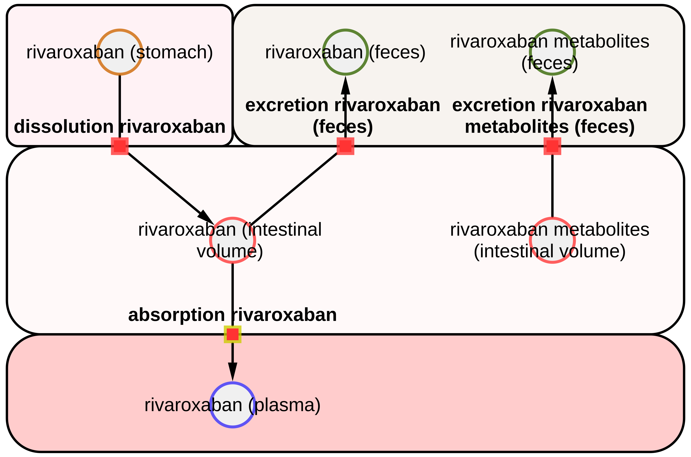
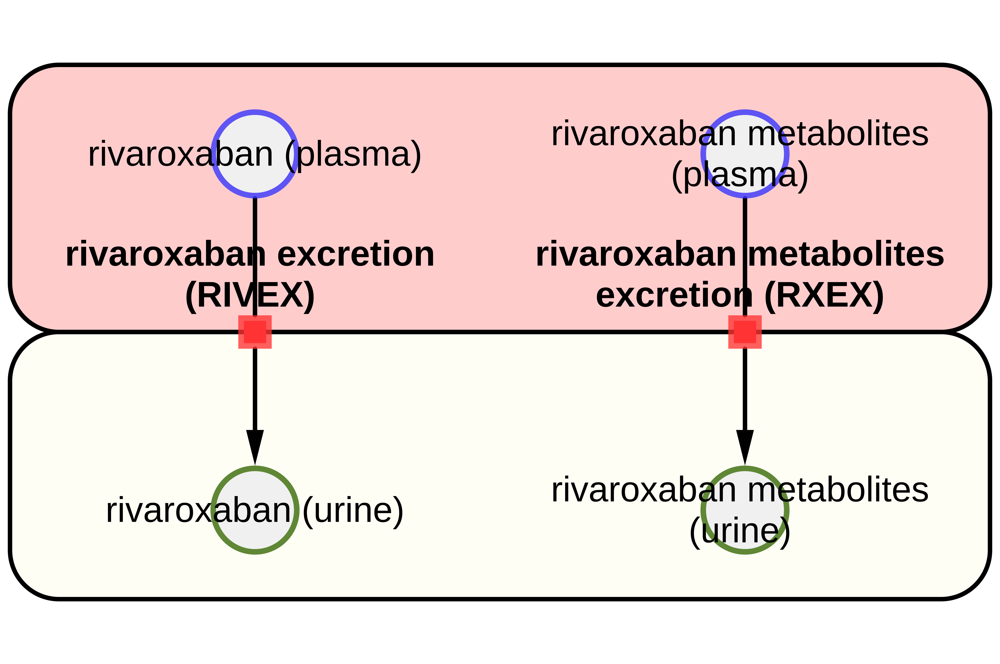
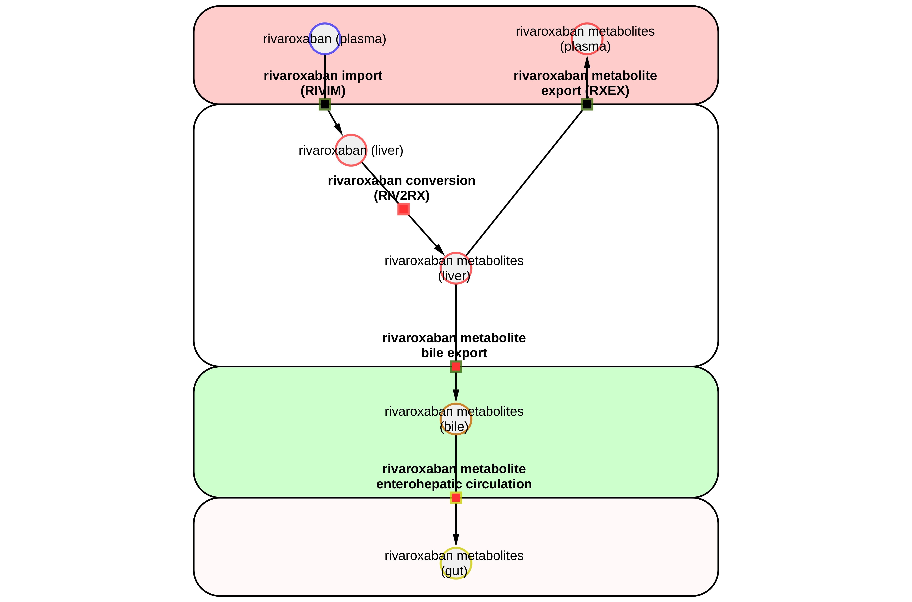

# Models

The models are distributed in [SBML](http://sbml.org) format.

## rivaroxaban_body

* Model: [`rivaroxaban_body.xml`](https://raw.githubusercontent.com/matthiaskoenig/rivaroxaban-model/main/models/rivaroxaban_body.xml)
* Equations: [`rivaroxaban_body.md`](https://github.com/matthiaskoenig/rivaroxaban-model/blob/main/models/rivaroxaban_body.md)
* Report: [SBML4humans](https://sbml4humans.de/report?url=https%3A%2F%2Fraw.githubusercontent.com%2Fmatthiaskoenig%2Frivaroxaban-model%2Fmain%2Fmodels%2Frivaroxaban_body.xml)

## rivaroxaban_body_flat

* Model: [`rivaroxaban_body_flat.xml`](https://raw.githubusercontent.com/matthiaskoenig/rivaroxaban-model/main/models/rivaroxaban_body_flat.xml)
* Equations: [`rivaroxaban_body_flat.md`](https://github.com/matthiaskoenig/rivaroxaban-model/blob/main/models/rivaroxaban_body_flat.md)
* Report: [SBML4humans](https://sbml4humans.de/report?url=https%3A%2F%2Fraw.githubusercontent.com%2Fmatthiaskoenig%2Frivaroxaban-model%2Fmain%2Fmodels%2Frivaroxaban_body_flat.xml)

## rivaroxaban_coagulation

* Model: [`rivaroxaban_coagulation.xml`](https://raw.githubusercontent.com/matthiaskoenig/rivaroxaban-model/main/models/rivaroxaban_coagulation.xml)
* Equations: [`rivaroxaban_coagulation.md`](https://github.com/matthiaskoenig/rivaroxaban-model/blob/main/models/rivaroxaban_coagulation.md)
* Report: [SBML4humans](https://sbml4humans.de/report?url=https%3A%2F%2Fraw.githubusercontent.com%2Fmatthiaskoenig%2Frivaroxaban-model%2Fmain%2Fmodels%2Frivaroxaban_coagulation.xml)

## rivaroxaban_intestine

* Model: [`rivaroxaban_intestine.xml`](https://raw.githubusercontent.com/matthiaskoenig/rivaroxaban-model/main/models/rivaroxaban_intestine.xml)
* Equations: [`rivaroxaban_intestine.md`](https://github.com/matthiaskoenig/rivaroxaban-model/blob/main/models/rivaroxaban_intestine.md)
* Report: [SBML4humans](https://sbml4humans.de/report?url=https%3A%2F%2Fraw.githubusercontent.com%2Fmatthiaskoenig%2Frivaroxaban-model%2Fmain%2Fmodels%2Frivaroxaban_intestine.xml)

{ style="max-height: 420px; width: auto; max-width: 100%" }

## rivaroxaban_kidney

* Model: [`rivaroxaban_kidney.xml`](https://raw.githubusercontent.com/matthiaskoenig/rivaroxaban-model/main/models/rivaroxaban_kidney.xml)
* Equations: [`rivaroxaban_kidney.md`](https://github.com/matthiaskoenig/rivaroxaban-model/blob/main/models/rivaroxaban_kidney.md)
* Report: [SBML4humans](https://sbml4humans.de/report?url=https%3A%2F%2Fraw.githubusercontent.com%2Fmatthiaskoenig%2Frivaroxaban-model%2Fmain%2Fmodels%2Frivaroxaban_kidney.xml)

{ style="max-height: 420px; width: auto; max-width: 100%" }

## rivaroxaban_liver

* Model: [`rivaroxaban_liver.xml`](https://raw.githubusercontent.com/matthiaskoenig/rivaroxaban-model/main/models/rivaroxaban_liver.xml)
* Equations: [`rivaroxaban_liver.md`](https://github.com/matthiaskoenig/rivaroxaban-model/blob/main/models/rivaroxaban_liver.md)
* Report: [SBML4humans](https://sbml4humans.de/report?url=https%3A%2F%2Fraw.githubusercontent.com%2Fmatthiaskoenig%2Frivaroxaban-model%2Fmain%2Fmodels%2Frivaroxaban_liver.xml)

{ style="max-height: 420px; width: auto; max-width: 100%" }

## COMBINE archive

The models and the metadata are available as COMBINE archive from [`rivaroxaban_model.omex`](https://raw.githubusercontent.com/matthiaskoenig/rivaroxaban-model/main/rivaroxaban_model.omex).
